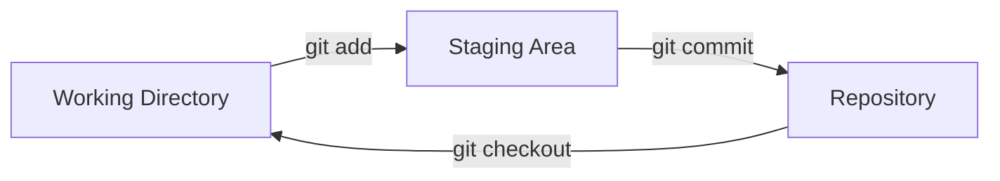
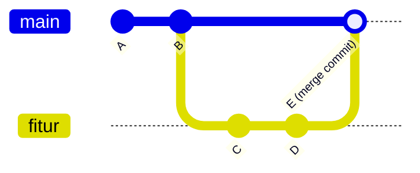
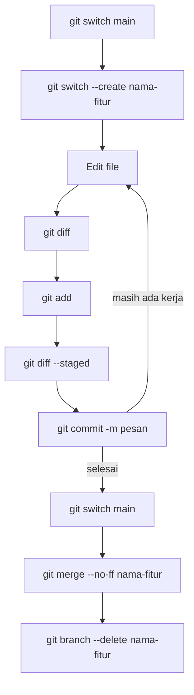

# Git Notes

Catatan dari exercise GitHub Skills: Introduction to Git.
Proyek latihan: game `stack-overflown`.

## 1. Konsep dasar

| Istilah | Arti |
|---|---|
| Version control | Sistem untuk mencatat perubahan file dari waktu ke waktu |
| Git | Version control yang terdistribusi. Setiap orang punya salinan lengkap history |
| Repository | Tempat semua file dan history proyek |
| Commit | Satu catatan perubahan di history. Punya hash ID, parent, author, waktu, dan pesan |
| Working directory | Folder file yang sedang kamu edit |
| Staging area (index) | Tempat menyiapkan perubahan sebelum commit |
| HEAD | Penunjuk posisi kamu sekarang di history |
| Branch | Label yang menunjuk ke satu commit. Dipakai untuk kerja terpisah dari `main` |
| main | Branch utama. Dianggap versi yang bisa dipercaya |

## 2. Alur kerja dasar



## 3. Setup awal (sekali saja per mesin)

```bash
git --version
git config --global user.name "Nama Saya"
git config --global user.email "email@example.com"
git config --global --list
```

- Git menyimpan nama dan email di history. Orang lain bisa melihatnya.
- Untuk privasi, pakai alamat noreply dari GitHub (Settings > Emails).
- Untuk satu proyek saja, ganti `--global` dengan `--local`.

## 4. Command yang dipakai

### Mulai dan simpan

| Command | Fungsi |
|---|---|
| `git init` | Buat repository baru di folder ini |
| `git status` | Lihat kondisi working directory dan staging |
| `git add <file>` | Pindahkan perubahan ke staging |
| `git add src/*` | Tambah semua file di folder `src` |
| `git commit -m "pesan"` | Simpan staging ke history |
| `git restore --staged <file>` | Keluarkan file dari staging |

### Lihat history

| Command | Fungsi |
|---|---|
| `git log` | History detail |
| `git log --oneline` | Satu commit per baris |
| `git log --graph --oneline` | Gambar graph history |
| `git log --all --graph --oneline` | Sama, tapi semua branch ikut tampil |

### Lihat perbedaan (diff)

| Command | Membandingkan |
|---|---|
| `git diff` | Working directory dengan staging |
| `git diff --staged` | Staging dengan commit terakhir |
| `git diff HEAD~1` | Commit sekarang dengan commit sebelumnya |

Di diff: `+` hijau = baris ditambah, `-` merah = baris dihapus.
Tekan `q` untuk keluar dari tampilan diff yang panjang.

### Pindah versi dan branch

| Command | Fungsi |
|---|---|
| `git checkout <commit id>` | Lihat versi lama. File di folder ikut berubah |
| `git checkout main` | Kembali ke commit terbaru di `main` |
| `git branch <nama>` | Buat branch baru |
| `git checkout <nama>` | Pindah ke branch |
| `git switch <nama>` | Pindah ke branch (cara baru, sejak Git 2.23) |
| `git switch --create <nama>` | Buat branch dan langsung pindah |
| `git branch --list` | Daftar branch |
| `git branch --move lama baru` | Ganti nama branch |
| `git branch --delete <nama>` | Hapus label branch yang sudah di-merge |
| `git merge <nama>` | Gabung branch ke branch yang sedang aktif |
| `git merge --no-ff <nama> -m "pesan"` | Merge dengan merge commit, branch tetap terlihat di history |

Catatan: `git branch --delete` hanya menghapus label, bukan isi commit.

## 5. Cara menggabung branch

Alur umum: pindah ke `main`, lalu merge branch fitur.

```bash
git checkout main
git merge --no-ff nama-fitur -m "pesan merge"
git branch --delete nama-fitur
```

Tiga jenis merge:

| Jenis | Hasil di history |
|---|---|
| Fast-forward | Commit branch fitur ditaruh lurus di `main`. Tidak ada commit baru |
| Merge commit (`--no-ff`) | Ada satu commit merge baru. Branch fitur tetap terlihat |
| Squash | Semua commit fitur jadi satu commit di `main` |



## 6. Alur lengkap fitur baru (lokal)



## 7. Di VS Code

- Tab **Source Control**: lihat file berubah, tekan `+` untuk staging, isi pesan, tekan **Commit**.
- Klik dua kali file di daftar Changes untuk melihat diff.
- Klik kanan header **Changes**, aktifkan **Graph** untuk lihat history.
- Klik nama branch di status bar kiri bawah untuk buat atau pindah branch.
- Menu `...` > Branch > Merge atau Delete Branch.
- Di exercise, merge lewat VS Code menghasilkan fast-forward.

## 8. Menulis commit message

- Pendek, jelas, spesifik. Hindari pesan generik seperti "update" atau "fix".
- Contoh dari exercise: `Add element for showing high score`.
- Tulis apa yang berubah, supaya bug di masa depan lebih mudah dicari.

## 9. Kolaborasi (pengenalan, belum dipraktikkan)

| Istilah | Arti |
|---|---|
| Clone | Salin repository dari remote ke komputer sendiri |
| Push | Kirim commit lokal ke remote |
| Pull | Ambil dan gabung perubahan dari remote |
| Pull request | Permintaan agar orang lain menggabung perubahan kamu |
